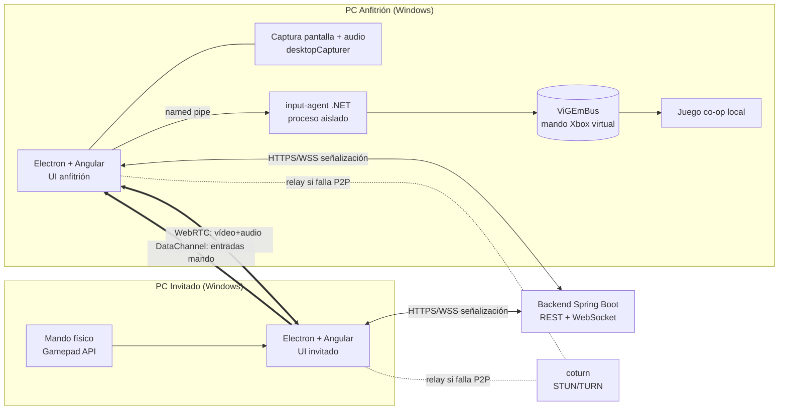
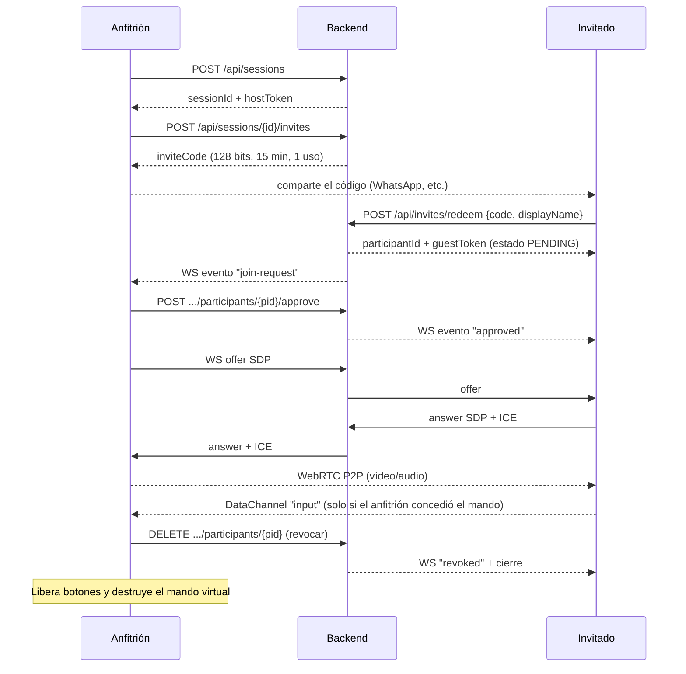

# Arquitectura — GameShare (Remote Play privado)

## 1. Entorno de desarrollo verificado (2026-10-20)

| Herramienta | Versión | Uso |
|---|---|---|
| Java | 21.0.1 LTS | Backend Spring Boot (Maven Wrapper, Maven no está instalado globalmente) |
| Node / npm | 24.9.0 / 11.6.0 | Electron + Angular |
| Angular CLI | 19.0.4 | UI de escritorio |
| .NET SDK | 8.0.303 | Agente de entrada (mando virtual) |
| Rust / cargo | 1.82.0 | No se usa en el MVP (alternativa futura) |
| Docker | 28.3.2 (daemon apagado) | coturn / backend en contenedor |
| GPU | NVIDIA GTX 1050 Ti | Codificación H.264 por hardware (NVENC) |
| ViGEmBus | Instalado y en ejecución | Driver de mando virtual |

## 2. Decisiones técnicas

### 2.1 Aplicación de escritorio: **Electron + Angular**

- **Electron** incluye Chromium completo: `desktopCapturer` para capturar ventana/pantalla, **audio loopback de sistema en Windows**, WebRTC nativo con codificación por hardware cuando está disponible y la **Gamepad API**.
- **Tauri** usa WebView2. Sirve, pero la captura de audio del sistema y el control de WebRTC son más limitados, y obligaría a escribir más código nativo en Rust.
- Angular es la tecnología preferida para la UI y encaja sin fricción en el *renderer* de Electron.
- Electron tiene un camino maduro de actualizaciones (`electron-updater`) para el futuro.
- Seguridad: `contextIsolation: true`, `nodeIntegration: false`, `sandbox: true` y un *preload* con una API mínima.

### 2.2 Streaming: **motor intercambiable, WebRTC propio por defecto**

| Opción | Licencia / condiciones | Integración | Decisión |
|---|---|---|---|
| WebRTC en Electron | BSD (libwebrtc), MIT (Electron) | Total, dentro de la app | **Motor por defecto del MVP** |
| Sunshine + Moonlight | GPL-3.0 | Solo como **proceso externo** (no enlazar el código) | Motor alternativo futuro: menor latencia (NVENC directo) |
| Parsec | Servicio comercial con sus propios términos y sin SDK abierto para este uso | No integrable; solo para validar el concepto manualmente | Fuera del código |

El diseño define una interfaz `StreamingEngine` (`start`, `stop`, `stats`, eventos). La señalización, la UI y los permisos no dependen del motor.

**Riesgo principal:** la latencia de WebRTC en Chromium (estimación de 60–120 ms extremo a extremo; está **sin medir**) es mayor que la de Sunshine/Moonlight (~20–40 ms en LAN). Para cooperativo local casual es aceptable. Si no lo fuera, el plan B es el motor Sunshine.

**Actualización (fase 4):** se verificó que WebRTC en Electron 44 usa **NVENC por hardware** con H.264 High y H.265, pero no con Constrained Baseline. Ver [07-streaming.md](07-streaming.md).

### 2.3 Mando virtual: **agente .NET aislado + ViGEmBus**

- **ViGEmBus** (BSD-3) es el único driver de mando Xbox 360 virtual de modo usuario ampliamente usado (lo usan Steam, Parsec y Sunshine). Está **retirado desde nov. 2023**: funciona, pero no recibirá parches. No existe un sucesor oficial publicado.
- Cliente: `Nefarius.ViGEm.Client` (NuGet, MIT) en un **proceso separado** `input-agent` (.NET 8).
- Electron (main) ⇄ `input-agent` por **named pipe local** con ACL del usuario actual. El agente solo sabe crear, actualizar y destruir mandos virtuales: no tiene acceso a teclado ni a ratón.
- Interfaz `GamepadBackend` para sustituir ViGEm en el futuro por otro driver sin tocar la lógica.
- El mando del anfitrión es físico y lo lee el juego directamente. El del invitado es un **segundo mando Xbox 360 virtual** independiente.

### 2.4 Backend de coordinación: **Spring Boot 3, sin base de datos**

- Estado en memoria (sesiones efímeras, de dos personas). PostgreSQL y Redis no hacen falta en el MVP.
- REST para sesiones e invitaciones y WebSocket para la señalización WebRTC y los eventos.
- Emite credenciales TURN temporales (HMAC, compatible con `coturn --use-auth-secret`).
- Docker Compose: `backend` + `coturn`.

**Pendiente de decidir (no bloquea):** dónde se aloja el backend para que ambos lleguen a él. Hay tres opciones: un VPS barato, un túnel (Cloudflare Tunnel) o el PC del anfitrión con un puerto abierto. TURN necesita IP pública con puertos UDP, así que un VPS es lo más simple.

## 3. Diagrama de componentes



El vídeo **nunca** pasa por el backend Java: va P2P (o por TURN, cifrado de extremo a extremo con DTLS-SRTP).

## 4. Flujo de conexión



## 5. Protocolo de entrada del mando (DataChannel `input`)

- Canal **no fiable y desordenado** (`ordered:false, maxRetransmits:0`): un estado viejo no sirve, así que solo vale el último.
- Mensaje binario de tamaño fijo (≈20 bytes): versión, `seq` (uint32), botones (uint16), LT/RT (uint8), LX/LY/RX/RY (int16).
- El anfitrión valida tamaño, versión y rangos; **descarta `seq` ≤ último** (anti-repetición y desorden); aplica un límite de 250 msg/s; ignora mensajes si el permiso de mando no está concedido.
- **Watchdog:** sin mensajes durante 500 ms → estado neutro (todo suelto). Al desconectar o revocar → neutro y destruir el mando virtual.
- Vibración: el anfitrión reenvía los eventos de vibración de ViGEm por el mismo canal, y el invitado usa `vibrationActuator` si está disponible.

## 6. Estructura del repositorio

```
gameshare/
  backend/        Spring Boot (Java 21, Maven Wrapper)
  desktop/        Electron + Angular
  input-agent/    .NET 8, ViGEm (proceso aislado)
  deploy/         docker-compose, configuración de coturn
  docs/           arquitectura, licencias, seguridad, pruebas
```
