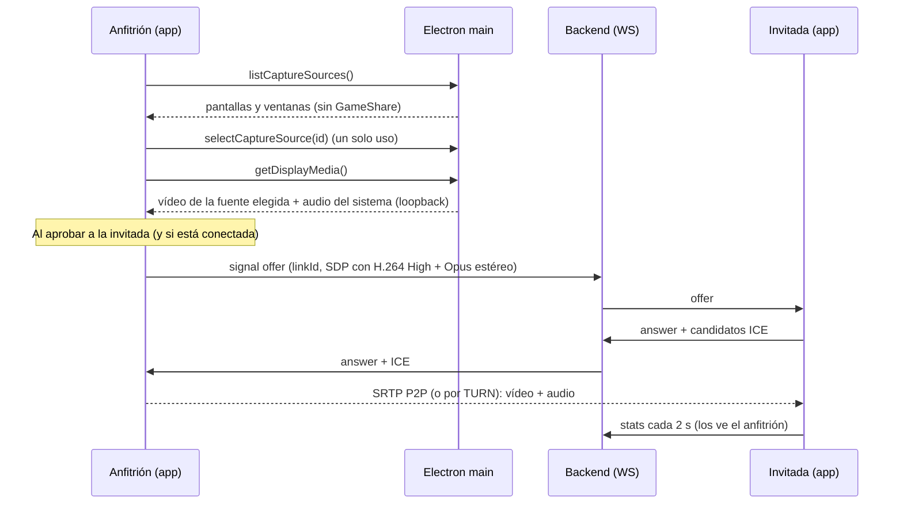

# Streaming de vídeo y audio (fase 4)

Motor: **WebRTC de Chromium (Electron 44)**, detrás de la interfaz `StreamingEngine` (`desktop/src/app/streaming/streaming-engine.ts`). Para cambiar de motor basta con cambiar una línea en `app.config.ts`.

## Cómo funciona



- **Solo el anfitrión envía** y la invitada solo recibe (transceivers `sendonly`), así que la invitada no puede enviar vídeo ni audio al anfitrión.
- Cada conexión tiene un `linkId` aleatorio, y las señales de conexiones antiguas se descartan.
- Todas las señales remotas se validan (`validateSignal`): tipo, tamaño y formato.
- La invitada solo acepta ofertas del anfitrión de su sesión, y solo si está aprobada.

## Decisiones medidas en este equipo (GTX 1050 Ti, driver 32.0.15.6094, Electron 44.9.3)

### Codificador por hardware

Se probó cada códec con captura de pantalla real (`encoderImplementation` / `powerEfficientEncoder` de `getStats`):

| Códec / perfil | Implementación | Hardware |
|---|---|---|
| H.264 Constrained Baseline `42e01f` | OpenH264 | ❌ software |
| H.264 Baseline `42001f` | MediaFoundation (NVIDIA H.264 Encoder MFT) | ✅ |
| H.264 Main `4d001f` | MediaFoundation (NVIDIA H.264 Encoder MFT) | ✅ |
| **H.264 High `64001f`** (por defecto) | MediaFoundation (NVIDIA H.264 Encoder MFT) | ✅ |
| H.265 / HEVC | MediaFoundation (NVIDIA HEVC Encoder MFT) | ✅ |
| VP8 / VP9 / AV1 | libvpx / libaom | ❌ software |

**Conclusión:** se prefiere H.264 High. Constrained Baseline, que es el perfil "clásico" de WebRTC, cae en software en Chromium/Windows. H.265 está disponible como opción avanzada. Con otra GPU (Intel/AMD) el resultado puede cambiar; la app muestra siempre qué codificador se usa.

### Audio

La captura del sistema llega por defecto **en mono y con procesado de voz** (cancelación de eco, supresión de ruido y control automático de ganancia), lo que estropea el audio de un juego. Se piden `echoCancellation:false, noiseSuppression:false, autoGainControl:false, channelCount:2`, y se verificó que llega estéreo y sin procesar. Opus se negocia en estéreo a 128 kbps.

### Baja latencia

- Pista con `contentHint = 'motion'` y `degradationPreference = 'maintain-framerate'`: ante poco ancho de banda baja la resolución, no los FPS.
- `maxBitrate` y `maxFramerate` según el preset; prioridad de red alta.
- En recepción: `jitterBufferTarget = 0` (búfer mínimo).
- Electron no ralentiza GameShare en segundo plano (`backgroundThrottling: false` y switches de Chromium), algo esencial porque el anfitrión juega con otra ventana delante.

### Presets de calidad

| Preset | Resolución | FPS | Bitrate máx. |
|---|---|---|---|
| Equilibrado (por defecto) | 1080p | 60 | 10 Mbps |
| Fluido | 720p | 60 | 6 Mbps |
| Ahorro | 720p | 30 | 3 Mbps |
| Máxima | 1080p | 60 | 20 Mbps |

El preset se puede cambiar mientras se transmite, sin cortar.

## Reconexión

- Si la conexión WebRTC pasa a `failed`, el anfitrión hace un **ICE restart**. Si vuelve a fallar en menos de 10 s, crea una conexión nueva.
- Si solo se cae el WebSocket de la invitada, **el vídeo sigue** (WebRTC es independiente de la señalización).
- Al revocar, al cerrar la sala o con el atajo de emergencia, la conexión se cierra de inmediato en ambos lados.
- "Detener" envía `bye`: la invitada vuelve a la pantalla de espera.

## Pruebas

| Prueba | Resultado |
|---|---|
| Unitarias: validación de señales (13 casos maliciosos o malformados), SDP estéreo, orden de códecs, cálculo de estadísticas | ✅ 21 pruebas |
| e2e (2 instancias + backend real): invitada pendiente **no** recibe nada; tras aprobarla, recibe vídeo que avanza y 1 pista de audio; conexión directa P2P; estadísticas en ambos lados; silenciar; desactivar el audio enviado; detener y reanudar; revocar corta el vídeo | ✅ |
| e2e de seguridad: no se puede capturar sin elegir en el selector, solo fuentes de la última lista, cámara y micrófono denegados | ✅ |

Ejemplo de una ejecución en un solo PC (loopback, pantalla con poco movimiento):

```
Envío    : 1920×1080 · 44 fps · 1.7 Mbps · H264 (NVIDIA H.264 Encoder MFT · hardware)
Recepción: 1920×1080 · 47 fps · 1.3 Mbps · pérdida 0.0 % · jitter 0 ms
```

> La e2e de streaming **captura la pantalla real** del equipo. Las capturas quedan en `desktop/test-results/`, que está excluido de git.

## Diagnóstico

`GAMESHARE_DEBUG=1` muestra en la consola del proceso principal las peticiones de permisos y de captura.

## Limitaciones conocidas y pendientes de validar

| Tema | Estado |
|---|---|
| **Dos PCs reales / Internet / NAT** | ⏳ Solo probado en un PC (loopback). Hay que validarlo con el PC de la invitada |
| **TURN** | ⏳ El código lo soporta (credenciales temporales y opción "Forzar TURN"), pero coturn no se ha levantado (Docker apagado) |
| **Latencia extremo a extremo** (pantalla→pantalla) | ⏳ Sin medir. La app muestra el RTT de red, no la latencia total |
| **Audio = todo el sistema** | En Windows, Chromium no puede capturar el audio de una sola ventana. **Si usáis Discord u otra llamada en el PC anfitrión, la invitada oirá su propia voz con retardo (eco)**. Alternativas: hablar por el móvil, o en el futuro un capturador nativo por proceso (WASAPI *process loopback*, Windows 10 2004+) |
| Juegos en **pantalla completa exclusiva** | Pueden capturarse en negro. Usar modo *ventana sin bordes* |
| Decodificador de la invitada | Chromium solo informa de la implementación del decodificador si la página está capturando, así que la invitada no ve si decodifica por hardware |
| Varios invitados | El motor admite varios, pero el backend limita a 1 (`max-guests`) |
