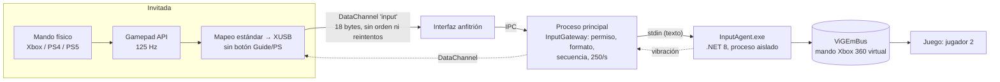

# Mando remoto (fase 5)

El mando de la invitada (Xbox, PS4/DualShock 4, PS5/DualSense u otro con mapeo estándar) aparece en el PC del anfitrión como un **segundo mando Xbox 360 virtual**, independiente del mando físico del anfitrión.

## Cómo funciona



| Pieza | Archivo | Responsabilidad |
|---|---|---|
| Lector del mando (invitada) | `desktop/src/app/input/guest-gamepad.service.ts` | Lee el mando a 125 Hz, envía solo si hay cambios o cada 100 ms (latido), y solo con permiso |
| Protocolo binario | `desktop/src/app/input/input-protocol.ts` y `desktop/electron/input-gateway.ts` | Mismo formato en los dos lados, con pruebas sobre los bytes exactos |
| Permisos (anfitrión) | `desktop/src/app/input/host-input.service.ts` | Un mando virtual por invitado **aprobado y con "Permitir mando"** |
| Barrera de seguridad | `desktop/electron/input-gateway.ts` | Valida cada trama en el proceso principal |
| Agente | `input-agent/src/InputAgent` | Crea, mueve y destruye mandos virtuales. Watchdog |
| Driver | ViGEmBus (instalado por el usuario) | Mando Xbox 360 virtual que ven los juegos (XInput) |

`IGamepadBackend` (agente) y el protocolo de texto por stdin permiten cambiar ViGEm por otro driver sin tocar Electron ni la interfaz.

## Instalación en el PC del anfitrión

1. **ViGEmBus**: descarga el instalador oficial firmado desde la página de releases de [nefarius/ViGEmBus](https://github.com/nefarius/ViGEmBus/releases) (usa la última publicada) y ejecútalo como administrador. Requiere reinicio en algunos equipos.
   - El proyecto está **retirado desde 2023**: funciona, pero no recibe actualizaciones.
   - Desactiva su actualizador automático, que contacta un dominio que ya no pertenece al autor. Usa la herramienta *Legacinator* de Nefarius, siguiendo su [declaración de fin de vida](https://docs.nefarius.at/projects/ViGEm/End-of-Life/).
   - Comprobar que está instalado: `Get-Service ViGEmBus` → `Running`.
2. **Runtime de .NET 8** (si no tienes el SDK): <https://dotnet.microsoft.com/download/dotnet/8.0>, "Desktop Runtime x64".
3. **Compilar el agente** (una vez):
   ```powershell
   cd input-agent
   dotnet publish src/InputAgent -c Release -o dist
   ```
   La app busca `input-agent\dist\InputAgent.exe`. Para otra ruta, define `GAMESHARE_INPUT_AGENT`.

El PC de la invitada **no necesita** ViGEmBus ni .NET.

## Uso

1. El anfitrión comparte la ventana del juego (el canal del mando viaja en la misma conexión WebRTC que el vídeo).
2. Acepta a la invitada y marca **"Permitir mando"**.
3. La invitada conecta su mando y pulsa cualquier botón. La app lo detecta (por ejemplo, "Mando PS4 (DualShock 4)"), muestra los botones pulsados en tiempo real e indica "Tu mando controla al jugador 2".
4. **Conecta tu mando físico antes** de dar el permiso, para que tú seas el jugador 1.

## Seguridad

| Medida | Dónde | Probado |
|---|---|---|
| Solo con permiso explícito del anfitrión; quitarlo desconecta el mando al instante | Interfaz, proceso principal y agente | ✅ e2e |
| Tramas de tamaño, versión o tipo incorrectos → descartadas | Proceso principal | ✅ unitarias |
| Anti-repetición: `seq` estrictamente creciente por conexión | Proceso principal | ✅ unitarias |
| Límite de 250 tramas/s (ráfaga 50) en el proceso principal y 500/s en el agente | Ambos | ✅ unitarias |
| Botón **Guide/PS bloqueado** en las tres capas (abriría la Xbox Game Bar o Steam del anfitrión) | Interfaz, proceso principal y agente | ✅ e2e con XInput real |
| Sin acceso a teclado ni ratón: el agente solo sabe manejar mandos virtuales | Agente | por diseño |
| Watchdog: sin datos durante 500 ms → se sueltan todos los botones | Agente | ✅ e2e (invitada cerrada de golpe con un botón pulsado) |
| Mandos destruidos al cerrar la app, al colgarse la interfaz, al cerrar la sala o con Ctrl+Shift+F12 | Proceso principal y agente | ✅ e2e (cierre de la app) |
| Si Electron muere, el agente recibe EOF, destruye los mandos y termina | Agente | ✅ prueba de proceso real |
| El agente solo escucha a su proceso padre (stdin/stdout), sin red | Agente | por diseño |
| La invitada solo acepta el canal `input` y tramas de vibración de 4 bytes | Interfaz invitada | ✅ unitarias |

## Pruebas ejecutadas en este equipo (con un mando físico PDP conectado en el puesto 0)

- **Agente (33):** protocolo (14 líneas inválidas rechazadas), lógica con mando simulado, y **ViGEmBus real**: el estado exacto aparece en XInput en un puesto nuevo, el watchdog suelta los botones, y al cerrar stdin el mando desaparece.
- **Proceso principal (12):** puerta de entrada (permisos, secuencia, frecuencia, puestos, vibración, reinicio del agente).
- **Interfaz (11):** mapeo estándar→XUSB (incluido el eje Y invertido), bytes exactos, identificación de mandos Xbox, PS4, PS5 y otros.
- **Extremo a extremo (2), con XInput real:**
  ```
  puesto 0: mando físico del anfitrión (en reposo)
  puesto 1: mando virtual → A + R2 + stick (16384, 32767); botón PS no transmitido
  ```
  Además: sin permiso no aparece ningún mando, soltar vuelve a neutro, cerrar la invitada de golpe suelta los botones, quitar el permiso o cerrar la app elimina el mando.

> El mando de la invitada se **simula** en las pruebas automáticas (Gamepad API sustituida). Hay que validar con mandos físicos reales.

## Limitaciones y pendientes

| Tema | Estado |
|---|---|
| **Mandos físicos reales de la invitada (Xbox y PS4)** | ⏳ Pendiente de probar en su PC. Chromium mapea ambos con el mapeo estándar en Windows |
| **Vibración** | Implementada en las dos direcciones, con pruebas unitarias. ⏳ No probada con un juego ni con un mando real |
| **Juego real con 2 jugadores** | ⏳ Pendiente (criterio de éxito del MVP) |
| Iconos en el juego | El juego ve un mando **Xbox 360**: con el mando de PS4 verás A/B/X/Y en pantalla (✕=A, ○=B, □=X, △=Y) |
| Orden de jugadores | Windows asigna el primer puesto libre. Conecta tu mando antes de dar permiso. ViGEm no siempre informa del puesto real, así que la app no muestra el número |
| Steam Input | Si Steam está abierto en el anfitrión, puede "capturar" el mando virtual. Si el juego no lo detecta, desactiva Steam Input para ese juego |
| Probar en un solo PC con mandos reales | La instancia "invitada" vería también el mando virtual creado por el anfitrión (bucle). Para pruebas manuales en un PC, usa un mando que no sea Xbox o prueba entre dos PCs |
| El canal del mando necesita streaming activo | El mando viaja en la conexión WebRTC del vídeo: el anfitrión debe estar compartiendo |
| Teclado y ratón remotos | No soportados, a propósito |
